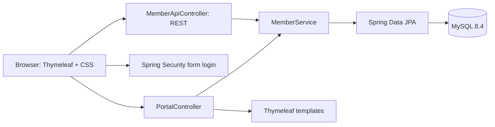
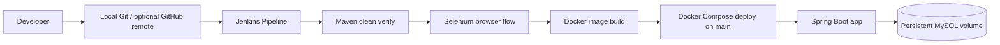

# Architecture

**Student:** AMANKUMAR JHA · **Roll No:** 23102C0072

## Runtime design

The UI and the API are served by one Spring Boot application. Controllers handle HTTP requests and validation, the service applies member operations and dashboard queries, and the repository persists entities through JPA. `Member` maps to the `members` table. Enums keep plan and status values consistent.

## CI/CD design

The pipeline runs in the Jenkins container with access to the Docker Desktop engine. Test application context uses H2, so unit and integration checks do not require a live database. The end-to-end stage uses the Compose MySQL service plus a Selenium Chrome Grid container. The deploy stage is branch-guarded and reads secrets from Jenkins credentials.

## Security boundaries

- Spring Security requires login for application routes. Admin and staff accounts are configured from environment variables and BCrypt-encoded at startup.
- Staff and admins may create, read, search, and update members. Only admins may change statuses.
- API calls require an authenticated role; the status endpoint is admin-only.
- Database and account passwords are not stored in tracked files. `.env` is ignored by Git; Jenkins uses Secret text credentials.
- The Jenkins container mounts the Docker socket for local lab builds and deploys. Treat this container as a trusted local administrator tool.

