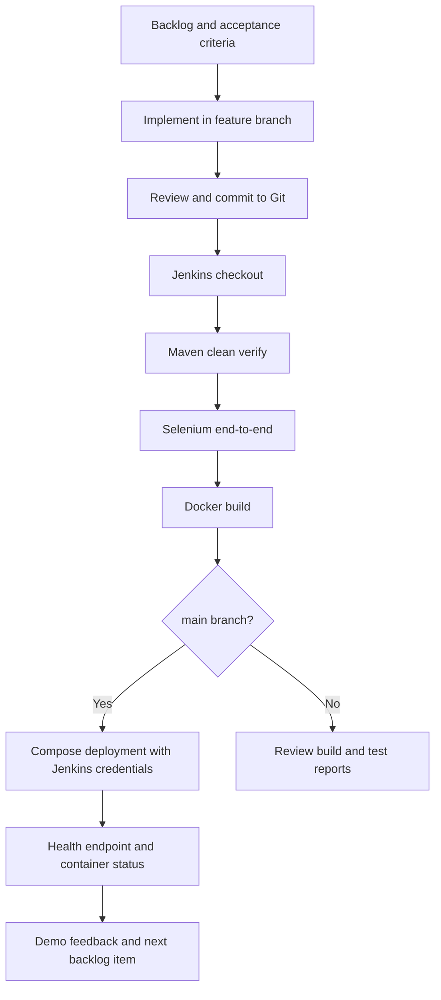

# CI/CD Workflow

**Student:** AMANKUMAR JHA · **Roll No:** 23102C0072

## Quality gates

1. **Build and JUnit:** `mvn clean verify`; failures fail the Jenkins build.
2. **Browser flow:** Selenium logs in, registers, searches, edits, and changes a membership status.
3. **Image:** Docker packages the Maven-built JAR.
4. **Deployment:** main branch only; the Compose app starts after the MySQL health check; the app exposes `/actuator/health`.

GitHub webhook delivery is not configured until the project has a remote repository and credentials. The local Jenkins pipeline can be run manually without claiming GitHub integration.

